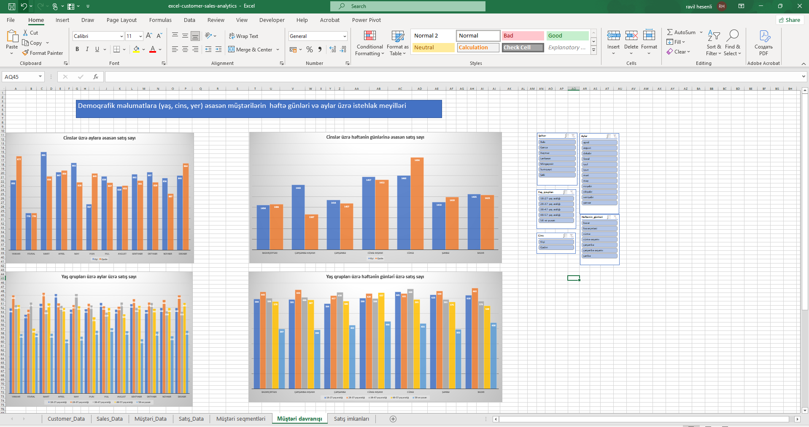
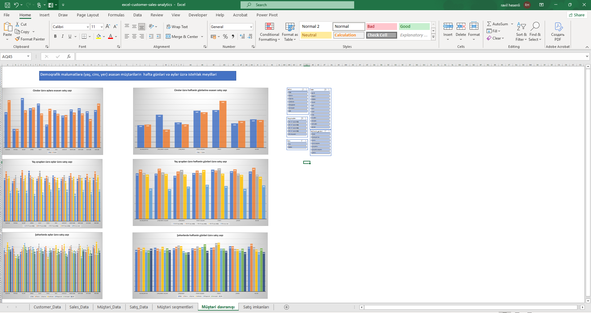
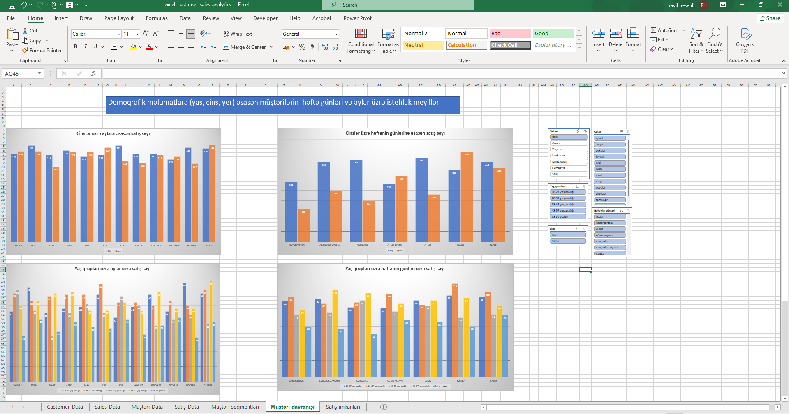
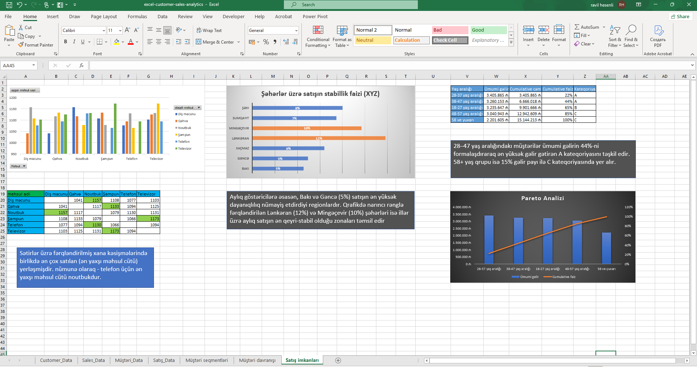

# 📊 Müştəri Davranışları və Satış Analizi Layihəsi (Excel, Power Query & Power Pivot)

# Layihə Haqqında Qısa Məlumat
Bu layihədə **çirkli və struktursuz xam satış və müştəri datası** ucdan-uca (End-to-End) emal edilərək, şirkətin strateji qərarlar almasına kömək edəcək interaktiv vizual analitika panelinə (Dashboard) çevrilmişdir. Layihə çərçivəsində ETL (Extract, Transform, Load) prosesi, data modelləşdirmə (Data Modeling) və müştəri seqmentasiyası analizləri aparılmışdır.

---

## 🛠️ İstifadə Olunan Alətlər və Texnologiyalar
* **MS Excel** (Qabaqcıl Səviyyə)
* **Power Query** (Data Təmizləmə və Transformasiya)
* **Power Pivot & DAX** (Data Modelləşdirmə və Hesablanmış Ölçülər)
* **Pivot Charts & Conditional Formatting** (Vizuallaşdırma və Dashboard)

---

# Data Transformasiyası (Əvvəl / Sonra)

### 1. Data Təmizləmə (Power Query ETL)
* **Xam Müştəri Datası (`Customer Data`):** Cinsiyyət sütununda qeyri-müəyyən kodlar təmizləndi və "Kişi/Qadın" formatına gətirildi. Yaş qrupları sütunu yaradıldı. Tarix formatları standartlaşdırıldı. `Müştəri Data` adında təmiz cədvəl əldə olundu.
* **Xam Satış Datası (`Sales Data`):** `Satış_ID` və `Müştəri_ID` əlaqələri nizamlandı. Tarixlərdən həftənin günləri və aylar çıxarılaraq yeni zaman ölçüləri əlavə olundu. `Satış Data` adında təmiz cədvəl yaradıldı.

### 2. Data Modelləşdirmə (Power Pivot)
* Dağınıq cədvəllər arasında **Fakt (Fact)** və **Dimensiya (Dimension)** əlaqələri qurularaq ulduz sxemi (**Star Schema**) relyasiyonal data modeli formalaşdırıldı.
* Təkrarlanan Excel funksiyaları (VLOOKUP/XLOOKUP) yerinə data model sayəsində performans optimallaşdırıldı.

---

## 📉 Biznes Analizləri və Dashboard İnsaytları

Layihənin sonunda qurulan vizual analizlərdən əldə olunan **əsas biznes nəticələri (Insights):**

### 📊 Müştəri Seqmentasiyası və Davranışları
* **Müştəri və Məhsul Trendləri:** Elektronika kateqoriyasında (xüsusilə Noutbuk) gənc müştərilərin (18-27 yaş) üstünlük təşkil etdiyi, yaş artdıqca isə gündəlik tələbat və qida məhsullarına (Diş macunu, Qəhvə) meylin artdığı müəyyən edilmişdir.

# Regionlar Üzrə Satışın Stabillik Faizləri
* **Satışın Stabillik Faizləri:** Şəhərlər üzrə satış analizində **Bakı və Gəncə** regionları ən yüksək dayanıqlılıq (stabil aylıq satış) göstərən zonalar, **Lənkəran və Mingəçevir** isə ən qeyri-stabil zonalar olaraq qruplaşdırılmışdır.

### 📈 Pareto Analizi (80/20 Qaydası)
* Gəlirlərin böyük hissəsinin **28-47 yaş** aralığındakı müştərilərdən və **C kateqoriyalı** məhsul qruplarından formalaşdığı Pareto diaqramı ilə sübut edilmişdir.

---

## 📂 Layihə Strukturunun Qovluğu
* 📁 `excel-customer-sales-analytics.xlsx` -> Layihənin əsas işçi Excel faylı
* 🖼️ `*.png` -> Hesabatların və data modelin skrinşotları
